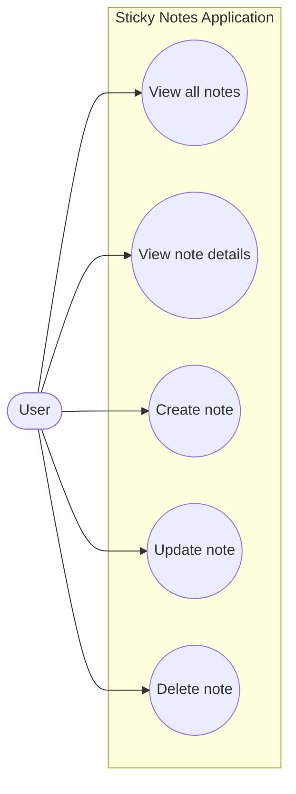
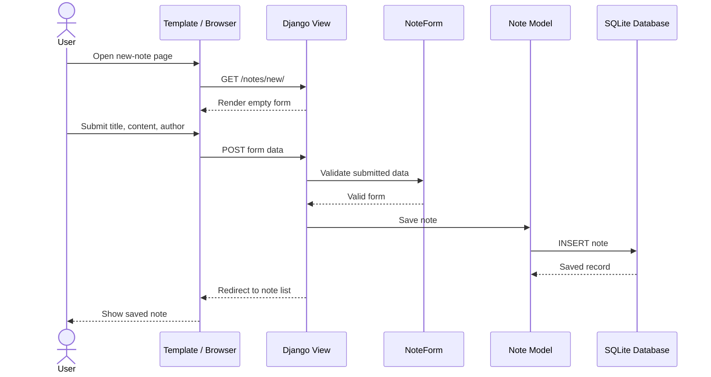
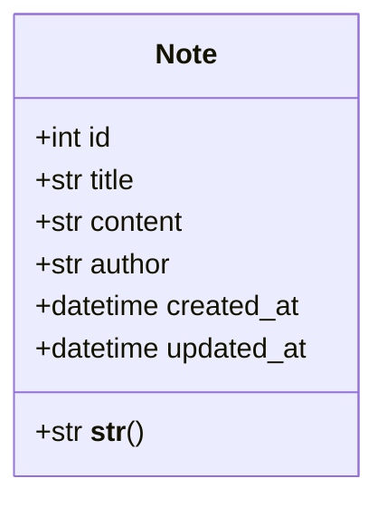
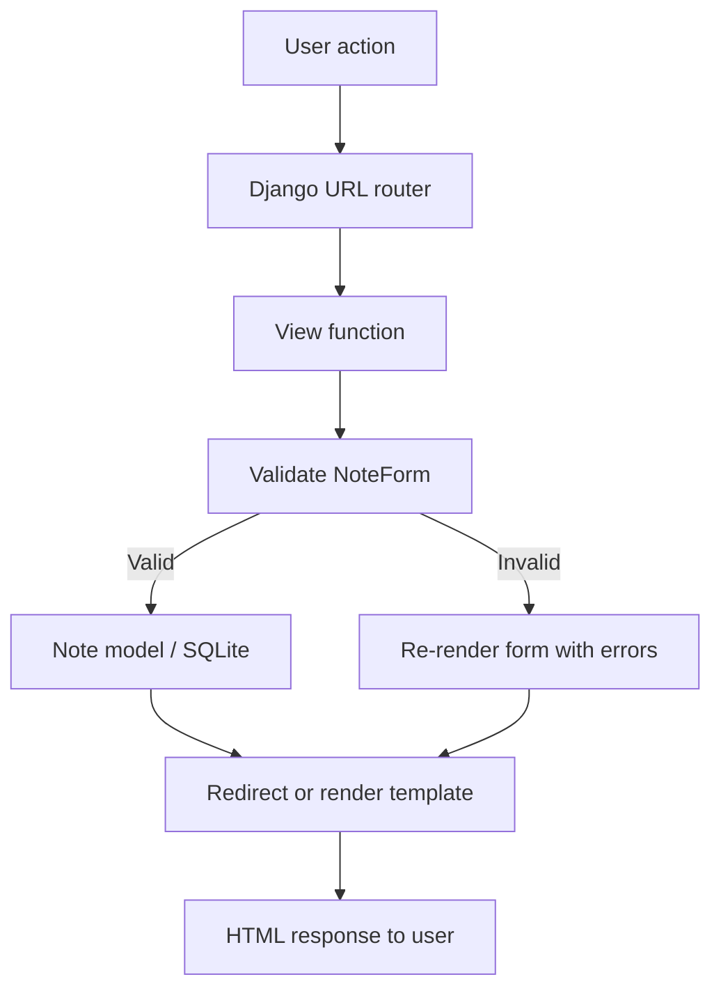

# Sticky Notes Application — Design Diagrams

These Mermaid diagrams can be rendered in Markdown viewers that support Mermaid.

## 1. Use-case diagram

## 2. Create-note sequence diagram

## 3. Model/class diagram

## 4. Request flow

## Component responsibilities
- **Model (`posts/models.py`)**: defines the note fields and database representation.
- **View (`posts/views.py`)**: receives requests, processes forms and chooses responses.
- **Template (`posts/templates/`)**: renders the pages and note information as HTML.
- **URL configuration**: maps browser paths to the correct view.
- **Form (`posts/forms.py`)**: validates user-entered data before it is saved.
